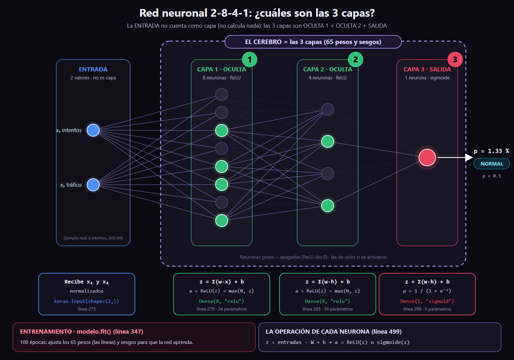

# NeuroGuard 3D — Red neuronal 2-8-4-1 para clasificar conexiones

**Asignatura:** Inteligencia Artificial · **Programa:** Ingeniería Informática · **Semestre:** Noveno
**Institución:** UNIPAZ · **Docente:** Ing. Esp. Jhonis Ríos M.

Red neuronal de tres capas, construida con **TensorFlow/Keras**, que clasifica conexiones informáticas **simuladas** como normales (0) o sospechosas (1) a partir de:

- **x₁:** número de intentos fallidos de inicio de sesión (0–20)
- **x₂:** tráfico enviado en megabytes (0–2000 MB)

Incluye una interfaz web propia, **NeuroGuard 3D**, conectada a la red entrenada.

> **Aviso académico:** los datos, probabilidades y clasificaciones tienen fines educativos. El resultado no confirma ni descarta la existencia de un ataque informático real.

---

## 1. Estructura del proyecto

```
Parcial jhony/
├── red_neuronal_estudiantes.py   # Red neuronal: datos, entrenamiento, evaluación y predicción (TODO 1-12 resueltos)
├── app.py                        # Servidor Flask: carga el modelo y responde a la interfaz
├── templates/index.html          # Estructura de la interfaz
├── static/css/estilos.css        # Diseño visual
├── static/js/app.js              # Lógica de la interfaz y comunicación con el servidor
├── static/js/red3d.js            # Red neuronal en 3D (Three.js)
├── static/js/graficas.js         # Mapa de decisión 2D animado y curvas de entrenamiento
├── static/js/superficie3d.js     # Superficie 3D de probabilidad (Three.js)
├── static/js/laboratorio.js      # Laboratorio: entrenar redes experimentales en vivo
├── static/js/umbral.js           # Umbral de decisión compartido por todas las vistas
├── static/js/manos.js            # ✋ Control de la red 3D con las manos (cámara web + MediaPipe)
├── static/vendor/mediapipe/      # MediaPipe Hand Landmarker local (funciona sin internet)
├── iniciar.bat                   # Inicio rápido con doble clic (Windows)
├── static/vendor/                # Three.js (copia local, funciona sin internet)
├── modelo/                       # Se crea al entrenar: modelo, normalizador y métricas
├── requirements.txt              # Librerías para el computador
├── requirements-servidor.txt     # Librerías para el servidor en internet (tensorflow-cpu + gunicorn)
├── Dockerfile                    # Cómo se arma el servidor (Hugging Face Spaces)
├── render.yaml                   # Configuración para publicar en Render
├── subir_a_huggingface.bat       # Publica (o actualiza) la página en internet con doble clic
├── despliegue/README_space.md    # Configuración del Space de Hugging Face
├── README.md                     # Este archivo
└── INFORME.md                    # Respuestas a las 15 preguntas del informe
```

## 2. Instalación

**Forma rápida (Windows):** doble clic en **`iniciar.bat`**. Crea el entorno con Python 3.13, instala las librerías, entrena la red si hace falta, inicia la interfaz y abre el navegador.

**Forma manual:**

> **Importante:** TensorFlow todavía no funciona en Python 3.14. Use **Python 3.13** (o 3.10–3.12).

En la terminal de Visual Studio Code, dentro de la carpeta del proyecto:

```bash
# 1. Crear un entorno virtual con Python 3.13
py -3.13 -m venv .venv

# 2. Activarlo
.venv\Scripts\activate          # Windows (PowerShell / CMD)
# source .venv/bin/activate     # Linux / macOS

# 3. Instalar las librerías
python -m pip install -r requirements.txt

# 4. Comprobar que se importan correctamente
python -c "import tensorflow, sklearn, numpy, flask; print('Librerías OK')"
```

## 3. Ejecución

```bash
# Paso 1: entrenar y evaluar la red (muestra todas las fases en consola y guarda el modelo en modelo/)
python red_neuronal_estudiantes.py

# Paso 2: iniciar la interfaz
python app.py
```

Abra el navegador en **http://127.0.0.1:5000**. Si no existe la carpeta `modelo/`, `app.py` entrena la red automáticamente antes de iniciar.

## 4. Arquitectura de la red (2-8-4-1)



Las **3 capas** son: oculta 1 (8 ReLU), oculta 2 (4 ReLU) y salida (1 sigmoide). La entrada no se cuenta como capa porque no calcula nada.

| Capa | Neuronas | Activación | Pesos | Sesgos | Parámetros |
|---|---|---|---|---|---|
| Entrada | 2 (x₁, x₂) | — | — | — | 0 |
| Oculta 1 | 8 | ReLU | 2 × 8 = 16 | 8 | 24 |
| Oculta 2 | 4 | ReLU | 8 × 4 = 32 | 4 | 36 |
| Salida | 1 | Sigmoide | 4 × 1 = 4 | 1 | 5 |
| **Total** | | | | | **65 entrenables** |

En cada neurona: `z = Σ(wᵢ·xᵢ) + b` y luego `a = ReLU(z) = max(0, z)` (capas ocultas) o `p = 1 / (1 + e^(−z))` (salida).
Regla de decisión: **p ≥ 0.5 → sospechosa**, **p < 0.5 → normal**.

Configuración del entrenamiento: optimizador **Adam**, pérdida **binary crossentropy**, **100 épocas**, lotes de **32**, **20 %** de validación, semilla **42**. Datos: 2000 conexiones simuladas (1191 normales, 809 sospechosas), 80 % entrenamiento (1600) y 20 % prueba (400), normalizadas con `StandardScaler`.

## 5. Resultados e interpretación de las métricas

Resultados con los 400 datos de prueba (semilla 42; pueden variar levemente en otro equipo):

| Métrica | Valor | Interpretación |
|---|---|---|
| Pérdida | 0.1988 | Error de las probabilidades frente a las etiquetas. Bajó de 0.6149 (época 1) a 0.2220 (época 100): la red aprendió. |
| Exactitud | 91.75 % | Acertó 367 de 400 conexiones. |
| Precisión | 88.62 % | De 167 alertas de "sospechosa", 148 eran reales y 19 fueron falsas alarmas. |
| Recall | 91.36 % | Detectó 148 de 162 conexiones sospechosas reales; 14 se le escaparon. |
| F1-score | 89.97 % | Equilibrio entre precisión y recall. |

Matriz de confusión: VN = 219, FP = 19, FN = 14, VP = 148.

La exactitud no llega a 100 % porque las etiquetas incluyen **ruido aleatorio**: algunas conexiones casi idénticas tienen etiquetas distintas, y ningún modelo puede acertarlas todas. Una exactitud alta solo indica que la red aprendió el patrón con el que se fabricaron los datos simulados, no que detecte ataques reales.

Casos de prueba de la Fase 6:

| Caso | Intentos | Tráfico | Probabilidad | Clasificación |
|---|---|---|---|---|
| Pocos intentos y poco tráfico | 2 | 100 MB | 0.06 % | Normal |
| Intermedio (caso docente) | 8 | 600 MB | 1.33 % | Normal |
| Intermedio alto | 11 | 1000 MB | 32.75 % | Normal |
| Muchos intentos y mucho tráfico | 18 | 1800 MB | 99.79 % | Sospechosa |

## 6. La interfaz NeuroGuard 3D

**Tecnología elegida: Flask + HTML, CSS y JavaScript (Three.js para el 3D).**
La elegimos porque Flask permite cargar el modelo de Keras en Python con muy poco código, y HTML/CSS/JavaScript da libertad total de diseño. Con eso pudimos construir una visualización 3D interactiva que Streamlit o Gradio no permiten con la misma libertad. Three.js se guarda en `static/vendor/`, así que la interfaz funciona sin internet.

Funciones (cubren los 12 requisitos mínimos del taller y agregan más):

- Nombre de la asignatura y título del proyecto en el encabezado.
- Campos de **intentos fallidos** y **tráfico (MB)** con botones +/− y deslizadores sincronizados.
- **Validación** en el navegador y otra vez en el servidor: campos vacíos, valores no numéricos, negativos, intentos con decimales y valores fuera de los límites. Muestra una advertencia si los valores salen del rango de entrenamiento.
- Botón **Analizar conexión** y un modo **"en vivo"** que analiza mientras se mueven los deslizadores.
- **Medidor** animado de probabilidad, **umbral** utilizado y **clasificación** normal o sospechosa.
- **Umbral modificable desde la plataforma** (de 0.05 a 0.95, sin tocar el código ni volver a entrenar). Al moverlo se actualiza todo a la vez: el medidor, el veredicto, la explicación, la frontera del mapa 2D, el plano de la superficie 3D, la red 3D, las métricas, la matriz de confusión y la tabla del laboratorio. Bajo el deslizador se ve cuánto cambian la precisión, el recall, las falsas alarmas y las no detectadas frente al umbral oficial. El botón "Volver a 0.5" restaura el valor oficial.
- Botón **Reiniciar todo**: con una confirmación, borra el historial y los experimentos del laboratorio (y detiene el que esté entrenando). Además devuelve el umbral a 0.5 y los datos de entrada a sus valores iniciales, para empezar de nuevo los ejercicios. El modelo oficial entrenado no se borra.
- **Descargar imagen explicada** (botón en el panel Resultado y en cada fila del historial): genera un PNG con el diagrama de las 3 capas y los valores reales de esa conexión. Incluye las neuronas encendidas y apagadas, la activación de cada una, la normalización, z y p de la salida, el umbral, la clasificación y la explicación.
- **Entrar a una neurona:** con doble clic (o doble toque en pantalla táctil) la cámara vuela hasta la neurona. Muestra arriba su z y su activación, y abajo su cálculo completo. Se sale con Escape, con "Salir ✕" o con "Centrar". En pantallas táctiles se gira con 1 dedo y se hace zoom pellizcando con 2.
- **⛶ Pantalla completa:** la red ocupa toda la pantalla, con el botón **"← Regresar"** para volver. Se abre sola al activar "✋ Manos" o con el botón "⛶ Completa".
- **✋ Control con las manos** (botón "Manos" en la vista 3D): el giro y el zoom se reparten a 60 cuadros por segundo para que el movimiento sea fluido. Usa la cámara web y MediaPipe Hand Landmarker, que corre en el navegador y no envía imágenes al servidor.
  - Mano abierta ✋ y moverla gira la red.
  - Apuntar con el índice ☝️ mueve el cursor.
  - Quedarse quieto 1 s sobre una neurona la selecciona, y 1 s más entra en ella.
  - Quedarse quieto 1 s sobre un botón lo pulsa (Regresar, Centrar, Salir).
  - Dos manos abiertas: separarlas acerca y juntarlas aleja.
  - Puño ✊ 1 s sale o centra la vista.
- **Curva sigmoide en vivo** de la neurona de salida: un punto se desliza por la curva en S hasta el valor z de la conexión analizada. Muestra cómo la sigmoide convierte z en la probabilidad p y en qué z corta el umbral: p ≥ umbral equivale a z ≥ ln(umbral / (1 − umbral)).
- **Explicación** generada a partir del resultado. Indica cuánto subió o bajó la probabilidad por cada entrada frente a una conexión promedio (valores de Shapley calculados con la red real).
- **Red neuronal 3D** con los pesos reales: color = signo del peso y grosor = magnitud. Los pulsos de luz recorren la red capa por capa y las neuronas brillan según su activación. Las neuronas ReLU apagadas (a = 0) no envían pulsos. Se puede girar y hacer zoom, y **al hacer clic en una neurona se muestra su cálculo** `z = Σ(w·x) + b` con los números reales.
- **Mapa de decisión 2D animado**: probabilidad de la red en todo el plano intentos × tráfico, frontera p = 0.5, curvas de nivel 0.25/0.75 y datos de prueba (con los errores marcados). Una lupa sigue al ratón y muestra la probabilidad. Al hacer clic o arrastrar se analiza esa conexión.
- **Superficie 3D de probabilidad**: el mismo mapa convertido en relieve y cortado por el plano del umbral p = 0.5. La intersección es la frontera de decisión. Al hacer clic sobre la superficie se analiza ese punto.
- **Laboratorio en vivo** (resultado de aprendizaje *"Modificar la arquitectura y observar cómo cambian los resultados"*): se elige la activación de las capas ocultas (ReLU, Tanh, Sigmoide o Lineal), la tasa de aprendizaje, las neuronas de cada capa y las épocas. La red se entrena con Keras en el servidor, y el mapa, la superficie y la curva de pérdida se transforman **época por época**. Cada experimento queda en una tabla comparativa junto al modelo oficial, que no se modifica.
- **Curvas de entrenamiento** (pérdida y exactitud por época) con tooltip y botón para reproducir el entrenamiento.
- **Métricas** y **matriz de confusión** reales.
- **Cálculo paso a paso**: normalización y valores z/activación de cada neurona en cada capa.
- **Historial** de las conexiones analizadas, con el umbral usado en cada una.
- Casos de prueba de la Fase 6 (bajo, intermedio, alto y aleatorio).
- Aviso de **demostración académica**.

## 7. ¿Cómo se comunica la interfaz con el modelo?

```
red_neuronal_estudiantes.py ──entrena──► modelo/red_neuronal.keras + normalizador.pkl + info_modelo.json
                                                         │ (se cargan una vez)
Navegador (app.js) ──fetch POST /api/analizar {intentos, trafico}──► app.py (Flask)
                                                         │ 1. valida los datos
                                                         │ 2. normalizador.transform()
                                                         │ 3. modelo.predict()  ← red real
                                                         │ 4. calcula z y a de cada neurona con los mismos pesos
Navegador ◄──────────── JSON {probabilidad, clasificación, explicación, recorrido} ┘
   └─ actualiza medidor, veredicto, red 3D, mapa, cálculo e historial
```

| Ruta | Método | Devuelve |
|---|---|---|
| `/` | GET | La página de la interfaz |
| `/api/modelo` | GET | Pesos, sesgos, métricas, historial de entrenamiento y datos de prueba |
| `/api/analizar` | POST | Resultado de la red para una conexión (o errores de validación con código 400) |
| `/api/mapa` | GET | Probabilidades de la red en una cuadrícula de 61 × 61 puntos |
| `/api/laboratorio/entrenar` | POST | Inicia el entrenamiento de una red experimental en segundo plano |
| `/api/laboratorio/estado` | GET | Época, pérdida, mapa de decisión y resultados del experimento en curso |
| `/api/laboratorio/detener` | POST | Detiene el experimento al final de la época actual |
| `/api/umbral` | POST | Devuelve las métricas recalculadas con un umbral (`{"umbral": 0.3}`) |
| `/api/reiniciar` | POST | Deja la plataforma como recién abierta (sin experimentos del laboratorio) |

**Umbral por usuario:** el servidor no guarda el umbral. Cada navegador lo envía en la cabecera HTTP `X-Umbral` en cada petición. Así, con la página publicada en internet, cada persona mueve su propio umbral sin cambiárselo a las demás.

### Efecto del umbral (modelo oficial, 400 datos de prueba)

| Umbral | Exactitud | Precisión | Recall | Falsas alarmas (FP) | No detectadas (FN) |
|---|---|---|---|---|---|
| 0.30 | 89.3 % | 80.8 % | 96.3 % | 37 | 6 |
| **0.50 (oficial)** | **91.8 %** | **88.6 %** | **91.4 %** | **19** | **14** |
| 0.70 | 90.0 % | 93.0 % | 81.5 % | 10 | 30 |

Bajar el umbral produce más alertas: se escapan menos ataques (sube el recall), pero hay más falsas alarmas. Subirlo produce el efecto contrario. La red y sus probabilidades no cambian: solo cambia la regla `p ≥ umbral`.

### Observaciones del laboratorio (semilla 42, mismos datos de prueba)

| Activación | Tasa | Épocas | Exactitud | Qué se observa |
|---|---|---|---|---|
| ReLU (oficial) | 0.001 | 100 | 91.8 % | Frontera bien definida y aprendizaje estable. |
| Tanh | 0.001 | 50 | 92.0 % | Resultado similar, con una frontera suave. |
| Lineal | 0.001 | 50 | 91.8 % | Solo puede trazar una recta. Aquí funciona porque la regla de los datos simulados es lineal. |
| Sigmoide | 0.0001 | 50 | 59.5 % | Con la tasa tan baja casi no aprende: la superficie queda plana y clasifica casi todo como normal. |

La interfaz no muestra resultados fijos ni inventados. Toda probabilidad sale de `modelo.predict()` sobre el modelo entrenado.

## 8. Publicar en internet (gratis) y uso en celulares

La página es **adaptable (responsive)**: se reorganiza sola en PC, portátil, tablet y celular. En pantallas táctiles la red 3D se gira con un dedo, se acerca pellizcando con dos dedos y con doble toque se entra a una neurona.

**Opción A (recomendada): Hugging Face Spaces (gratis).** Ofrece 16 GB de RAM, de sobra para TensorFlow, y HTTPS, que el navegador exige para usar la cámara en el control con las manos. Render también funciona (opción B), pero con 512 MB de RAM va más justo.

Pasos:

1. Crear una cuenta gratis en <https://huggingface.co/join>.
2. Crear un token de tipo **Write** en <https://huggingface.co/settings/tokens>.
3. Hacer doble clic en `subir_a_huggingface.bat`, pegar el token cuando lo pida y escribir el usuario.
4. Esperar de 5 a 10 minutos mientras se construye el servidor.
5. La página queda en `https://USUARIO-neuroguard-3d.hf.space`.

Para actualizar la página después de cambiar el código, se vuelve a ejecutar el mismo `.bat`.

Cómo funciona: el `Dockerfile` arma un Linux con Python 3.13, instala `requirements-servidor.txt` y arranca la app con **gunicorn** (servidor web de producción) en el puerto 7860. Se usa **un solo proceso con 8 hilos**, porque el laboratorio guarda su estado en memoria. El modelo ya entrenado (`modelo/`) se sube con el proyecto, así que el servidor no necesita entrenar.

**Opción B: Render (gratis).** Render necesita el proyecto en **GitHub** y usa el archivo `render.yaml` que ya está en el proyecto.

1. Crear un repositorio vacío en <https://github.com/new>, por ejemplo `neuroguard-3d`.
2. Subir el proyecto desde la terminal de VS Code, cambiando `USUARIO` por el de GitHub:
   ```bash
   git init
   git add .
   git commit -m "NeuroGuard 3D"
   git branch -M main
   git remote add origin https://github.com/USUARIO/neuroguard-3d.git
   git push -u origin main
   ```
3. En <https://dashboard.render.com> elegir **New → Blueprint**, conectar GitHub y escoger el repositorio. Render lee `render.yaml` y crea el servidor.
4. Esperar de 5 a 10 minutos. La página queda en `https://neuroguard-3d.onrender.com`, o con un sufijo si ese nombre ya está ocupado.

Diferencias de Render gratis frente a Hugging Face:
- Solo da **512 MB de RAM**. NeuroGuard usa unos 330 MB en reposo y unos 360 MB al entrenar en el laboratorio, así que alcanza, pero justo.
- Tiene **poca CPU**, así que el laboratorio entrena más lento.
- **Se duerme a los 15 minutos** sin visitas y tarda 1 a 2 minutos en despertar.

**Limitaciones del plan gratuito:**
- Si nadie visita la página en unas 48 horas, el Space se duerme; la siguiente visita lo despierta en 1 a 2 minutos.
- El **laboratorio** es compartido: si dos personas entrenan a la vez, la segunda debe esperar a que termine el entrenamiento en curso. El botón "Reiniciar todo" también borra los experimentos del laboratorio para todos (el umbral y el historial de cada persona no se tocan).
